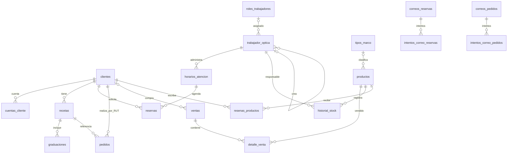

# Base de datos

## Motor y fuentes

La aplicación utiliza MySQL 8.0 (Compose principal y Compose E2E) con `utf8mb4` y `utf8mb4_unicode_ci`. El nombre configurado por Compose es `optica_db`. El esquema canónico de inicialización está en `database/schema.sql`; `database/insert.sql` aporta datos de ejemplo. La base E2E importa el mismo esquema y su seed sintético separado. EF Core se configura en `Optica.Api/Data/OpticaDbContext.cs` mediante el proveedor MySQL.

## Tablas

| Tabla | Propósito/columnas destacables |
|---|---|
| `clientes` | `id_cliente`, `rut`, `nombre`, `apellido`, `telefono`, `correo`, `estado`, `fecha_registro`; RUT y correo son únicos. |
| `cuentas_cliente` | Cuenta/credenciales de acceso del cliente; FK única a cliente. No se documentan ni exponen hashes. |
| `recetas` | Receta vinculada a cliente; PK `id_receta`, FK `id_cliente`. |
| `graduaciones` | Valores de graduación por receta y ojo; FK `id_receta`, restricción única receta/ojo. |
| `catalogos` | Valores de catálogo por tipo; combinación tipo/nombre única. |
| `tipos_marco` | Tipos de marco y sus datos de diseño/estado. |
| `productos` | `codigo`, `nombre`, marca/modelo/color, `categoria`, `precio`, `stock`, `stock_minimo`, estado `Disponible`/`Agotado`, imagen y tipo de marco opcional. |
| `pedidos` | `rut`, `id_receta` opcional, `fecha`, estado (`Pendiente`, `En proceso`, `Listo`, `Entregado`, `Cancelado`), `total`, `anotaciones`. |
| `ventas` | Cabecera con `id_cliente` opcional, `fecha` y `total`. |
| `detalle_venta` | `id_venta`, producto opcional, nombre, cantidad, precio unitario y subtotal. FKs a venta y producto. |
| `roles_trabajadores` | Rol de personal y permisos serializados. |
| `trabajador_optica` | Personal, tipo de usuario, rol y administrador creador. Check limita tipo a Administrador/Trabajador y exige rol al trabajador. |
| `historial_stock` | Movimientos/historial de stock, producto y trabajador responsable; ambas relaciones restringen eliminación. |
| `horarios_atencion` | `id_administrador`, `fecha`, `hora_inicio`, `hora_fin`, estado `Habilitada`/`Inhabilitada`; combinación fecha/hora de inicio única. |
| `reservas` | Cliente, horario, motivo, hashes de tokens y marcas de recordatorio; estado `Pendiente`, `Confirmada`, `Cancelada` o `Realizada`. La API controla reserva activa única por horario. |
| `correos_reservas` | Cola de notificaciones con `id_reserva`, `id_horario`, tipo, destinatario, asunto, cuerpo HTML protegido y reintentos. El esquema no declara FK para `id_reserva` ni `id_horario`. |
| `intentos_correo_reservas` | Registro de intentos vinculado a correo de reserva; FK con borrado en cascada. |
| `correos_pedidos` | Cola de notificaciones con `id_pedido`, destinatario, cuerpo y estado de envío; `id_pedido` no tiene FK declarada en el esquema. |
| `intentos_correo_pedidos` | Intentos asociados a correo de pedido; FK con borrado en cascada. |
| `tipos_rostro` | Tipos de rostro administrables para la recomendación. |
| `formas_lente` | Formas de lente usadas por el módulo de marcos. |
| `resenas_productos` | Reseña de cliente/producto; calificación 1–5 y una reseña por cliente/producto. |

## Relaciones y restricciones destacadas

Además de las claves primarias, el esquema declara índices para recetas/cliente, pedidos/cliente y estado, reservas/horario y recordatorios, categoría/stock de productos, unicidades de cuenta/horario/catálogo/reseña y checks de tipo de personal/calificación. Las FKs especifican reglas de borrado: por ejemplo, producto→tipo de marco y venta→cliente usan `SET NULL`; historial stock restringe borrar producto/responsable; detalle de venta referencia sus padres. Consulta `schema.sql` para longitudes, tipos y reglas exactas.

## Migraciones e inicialización

La carpeta `database/migraciones/` contiene `001_fk_pedidos_cliente_on_update_cascade.sql`, que cambia el comportamiento de actualización de la FK del RUT de pedidos. No se encontró un historial de migraciones EF Core en el repositorio. El Compose principal monta `schema.sql` en la inicialización de MySQL; `insert.sql` no está montado por ese Compose. El Compose E2E monta schema y seed sintético de solo lectura.

## Diferencias entre entornos

- **Desarrollo local:** Compose principal usa el volumen persistente `optica_mysql_data`; los scripts de inicialización aplican al crear la base vacía. Es posible tener datos locales de trabajo.
- **E2E:** MySQL temporal, `tmpfs`, schema y datos sintéticos dedicados; no persiste tras retirar el servicio. No reutiliza la base local.
- **Servidor externo:** el repositorio no describe la instancia remota, su versión efectiva, estrategia de backups/migraciones ni su proceso de actualización. No asumir que coincide con el volumen local o con E2E.

No incluir registros de `insert.sql` ni datos de usuarios en la documentación. La lista de tablas se obtuvo del esquema y debe actualizarse al cambiarlo.
